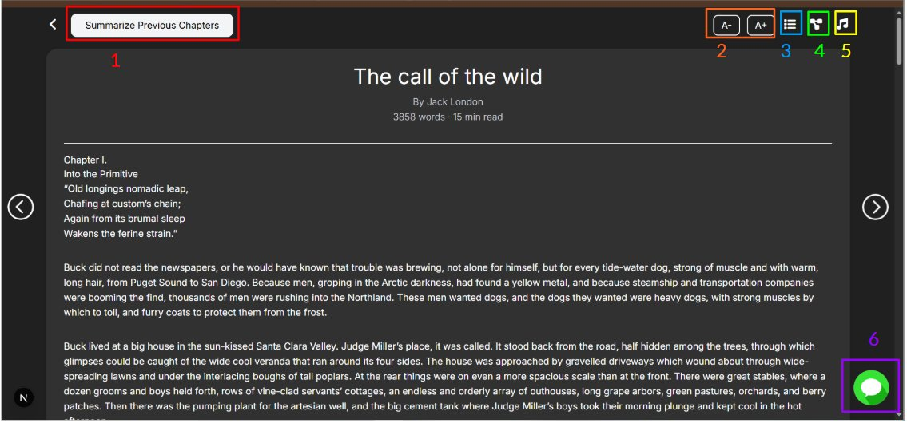
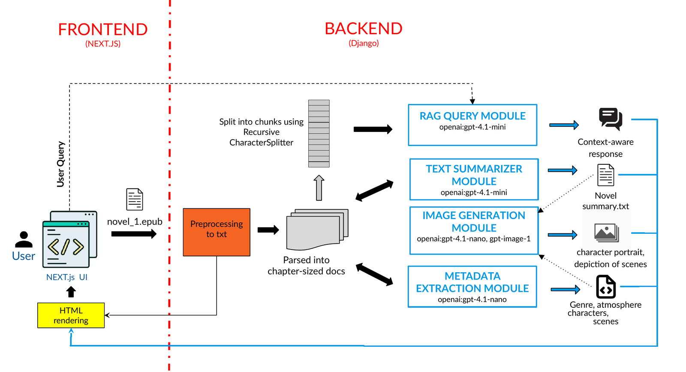

# Augmented Reader


Augmented Reader is a web application designed to provide an enhanced reading experience for readers by augmenting any ebook.



- [Features](docs/FEATURES.md)
- [Tutorial + solving setup issues](docs/TUTORIAL.md)
- [Evaluation](eval/README.md)

## Architecture



## Structure
- `backend/` Django API
- `frontend/` Next.js app
- `docs/` features and tutorial
- `eval/` evaluation notebooks and results
- `samples/` sample epub (public domain)

## Prerequisites
- Python 3.12+
- Node.js 18+ (or 20+)

---

## Backend Setup (Django)
Initially slow, as it has to build all vector stores and DB structures
```powershell
cd backend
python -m venv venv
.\venv\Scripts\Activate.ps1
pip install -r requirements.txt

Copy-Item .env.example .env
# Edit backend/.env with real values

python manage.py migrate
python manage.py runserver
```

## Frontend Setup (Next.js)
In another terminal:
```powershell
cd frontend
npm install

npm run dev
```
