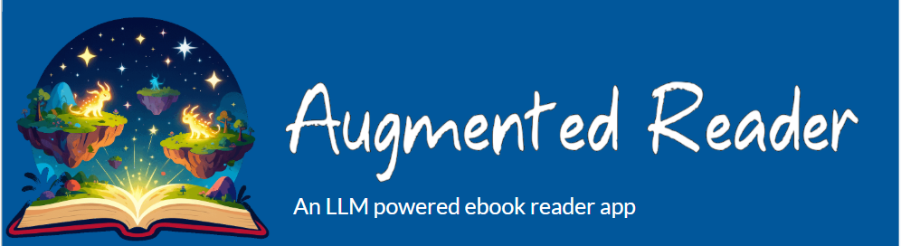
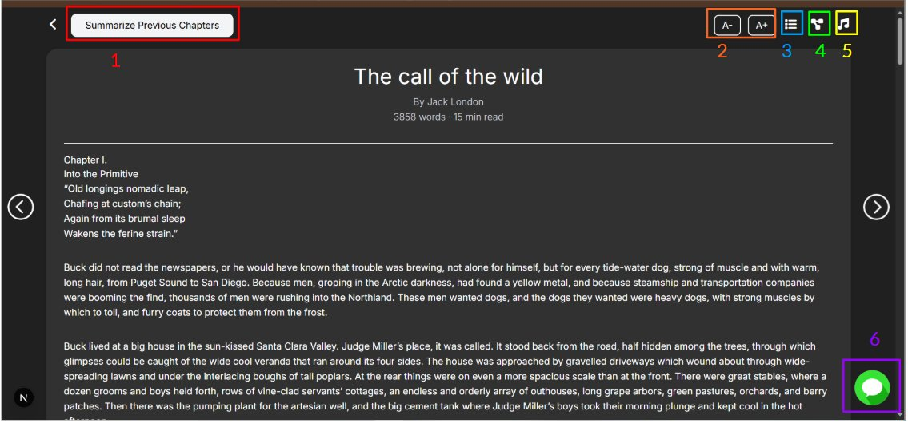
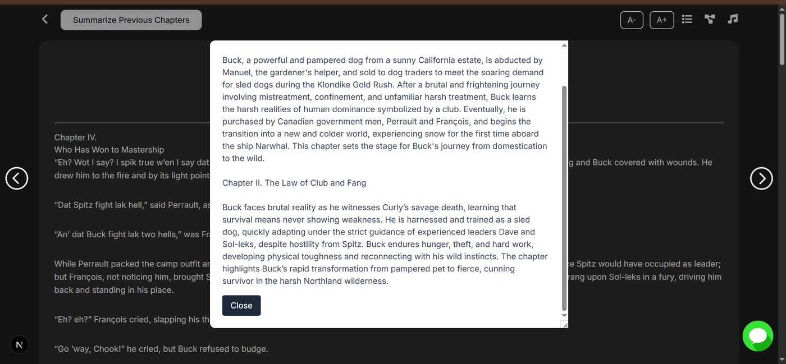
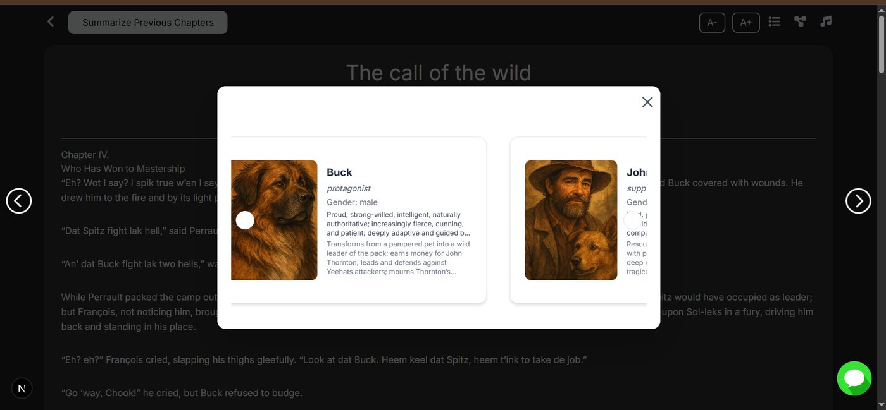
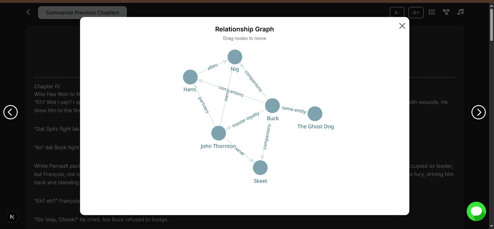
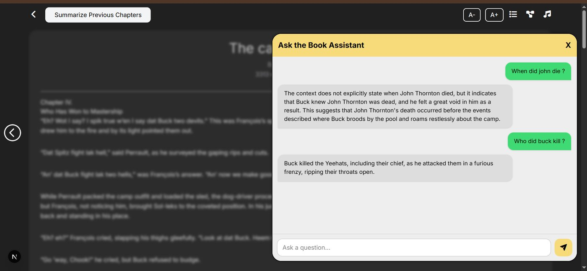
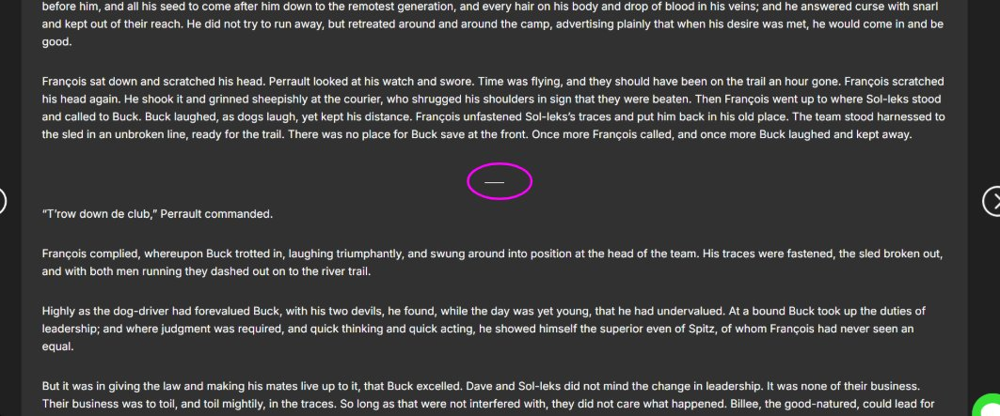
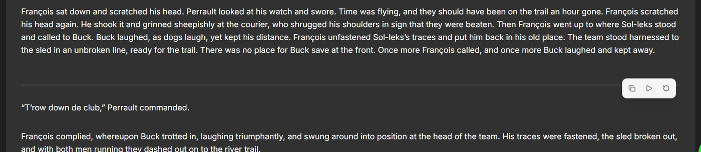
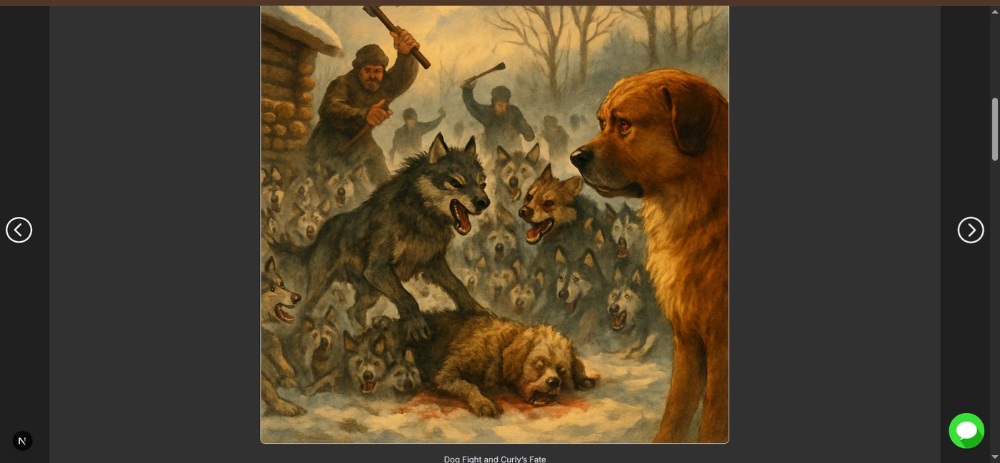

# Augmented Reader:

## Overview:

**Augmented Reader** is a web application designed to provide an enhanced reading experience for readers by augmenting any ebook.

The app leverages 4 LLM tools (text summarization, image generation, metadata extraction and RAG querying ) to transform static books into interactive, enriched reading experiences. These tools work together to help readers better understand narratives, explore characters and events, and interact with the content beyond traditional reading.

---

## What Problem Does It Solve?

- For many young people, interactive forms of entertainment make traditional book reading feel boring by comparison.
- Amateur authors who publish online or write as a hobby find it hard to stand out compared to professional authors .

**Augmented Reader** addresses these challenges by:

- Providing an interactive book-reading experience tailored to younger generations.
- Enhancing the appeal of the product that book authors are offering.

### Target Audience:

- Current ebook readers
- Young people
- Amateur authors

---

## Reader interface:

The reader interface above renders the content of one chapter and displays it. It also displays the word count, author, and estimated reading time. Furthermore, several features powered by LLM modules enhance reading experience.

**Feature 1** – Previous chapter summarization.
Suppose a user is reading some chapter. Selecting this feature will display a summary of all chapters from the start of the novel up to the current chapter.

**Feature 2** – Increase and decrease text size

**Feature 3** – Character sheet display
This feature generates a character sheet displaying up to six main characters, with details such as name, gender, personality, physical description, biography, as well as a generated character portrait.

**Feature 4** – Relationship graph
This feature generates a relationship network graph between characters in the novel with the edges describing the nature of the relationship.

**Feature 5** – Background music
For each chapter, the user can toggle the music button which plays a music that matches automatically the mood and tempo of the chapter.

**Feature 6** – Book assistant
The user has access to a book assistant that answers user queries related to anything in the book.

**Feature 7** – Scene image generation
The chapter is split into scenes. The marker below separates two scenes in a chapter.

When we hover over the marker, the image generation icon for the scene above the line is displayed.

On clicking the play button, the scene generation tool displays an image of scene with caption(wait 1- 2 min).

---

## Why Use Augmented Reader ?

Augmented Reader transforms the traditional and static book reading experience in a more interactive one, leveraging AI-powered summaries, image generations, and querying. Readers benefit from deeper immersion and enjoyment of the source, while authors end up with an improved finished product. Furthermore, the generation costs are only about 7-10 cents per book excluding scene generations, which seems reasonable for the experience it provides.
