# TUTORIAL:

1. Follow setup instructions in [README.md](../README.md) on github:

   a. Once web app is loaded for the first time, go to http://localhost:3000. You will have access to the homepage. There will be some placeholders that are replaced as you upload more ebooks.

   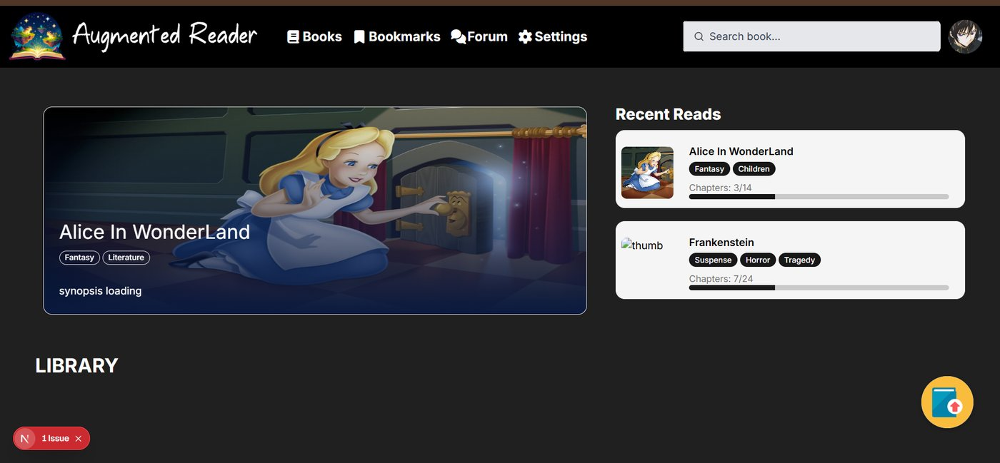

   b. Should you encounter the error below, directly set your OPENAI_API_KEY in the .env file and skip copy from env.example from the setup. After that, it should work

   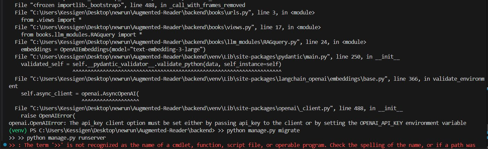

2. a. Click on the 'upload book' icon at the bottom right of the screen to upload an epub file.

   

   b. For this tutorial, we will choose an ebook from public domain ebooks from the gutenberg website. A sample epub has been provided in the [samples](../samples/) folder. If you wish, you can instead choose any ebook. However, this app has been built and works best with the older epub file versions. The file format is available on project gutenberg as shown below (in red):

   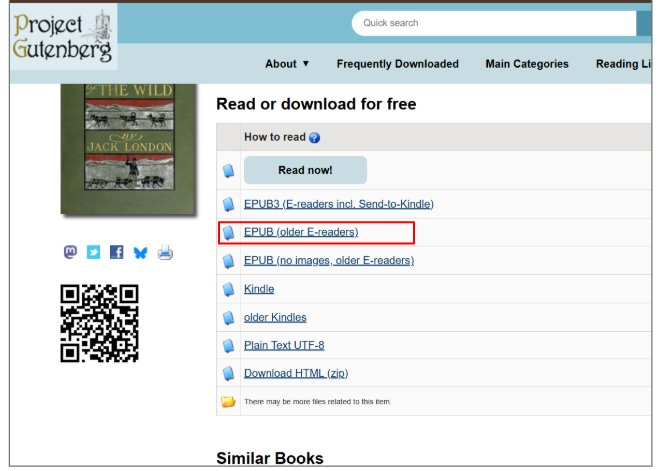

3. Loading will take some time (5 min) for the first book since backend is building the vector stores and DB for the first time. Once it is processed,You will receive a notification in the front end. You can then refresh the webpage and the new ebook sample.epub will be visible under the library section.

   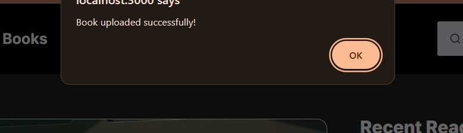

   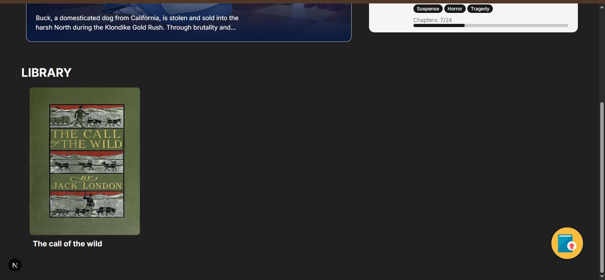

4. Click on it. You now have access to the reader interface and all its features.

   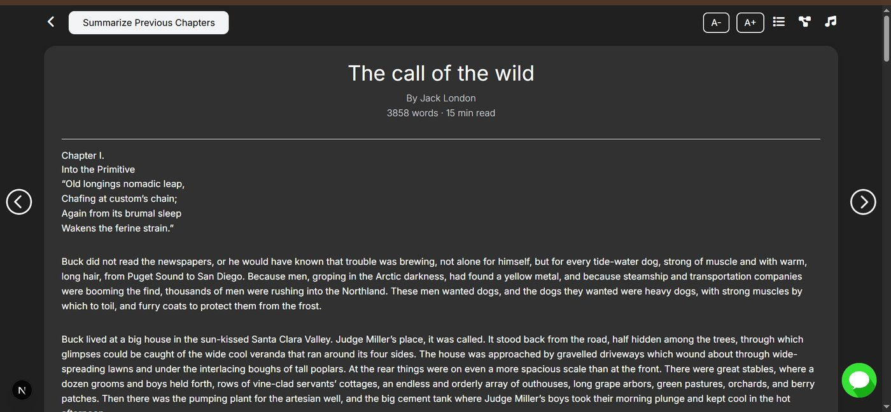

## IN DEPTH VIEW OF DATA MODELS:

Should you be interested in visualizing the internal data structures and relationships that we obtain after processing the ebook, you can use django admin to view the tables created.

1. Creating a django superuser :

   a. If project is running, go to terminal where the backend is running and do Ctrl+ C. This stops the execution.

   b. Create a new django admin superuser by entering the command:
   `python manage.py createsuperuser`

   c. You will be prompted to enter your name, email and password. Just use fake details.

   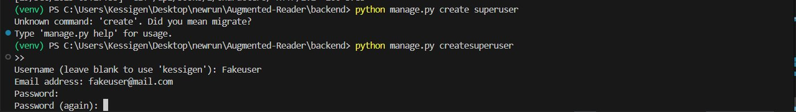

   d. Once user is created successfully, restart the server using the command:
   `python manage.py runserver`.

   e. Go to the admin view in your browser http://127.0.0.1:8000/admin and login with user you created earlier

   f. You now have access to the app tables:

   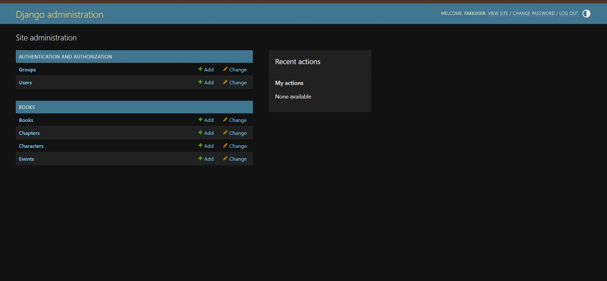

   g. You now have access to all the book, chapters and event objects in the DB. For example :

   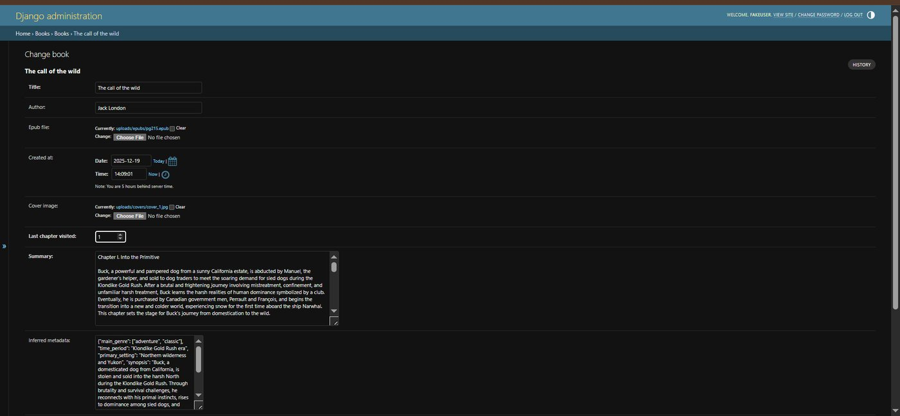

The full view for one instance of sample.epub is shown below:

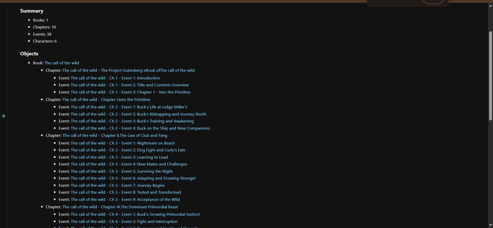

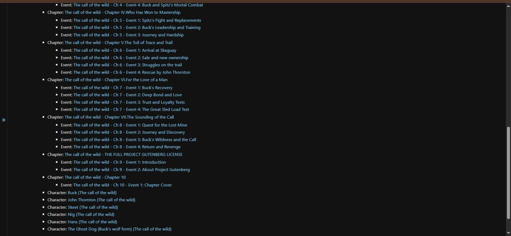
